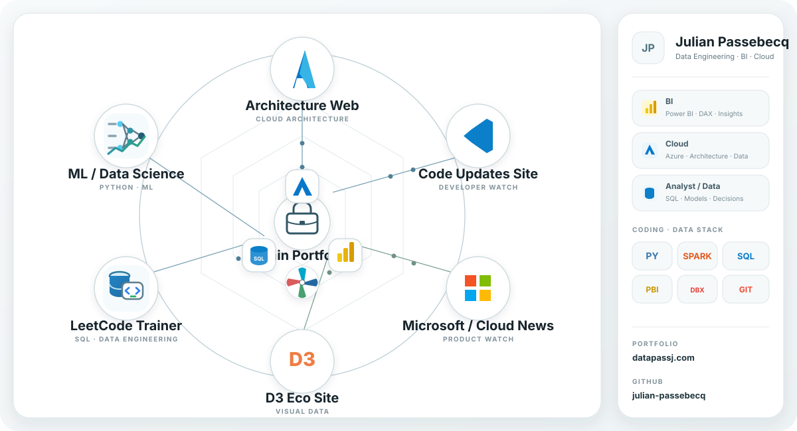

# Julian Passebecq

**Cloud BI Consultant · Data & Analytics Engineering**  
Oslo, Norway

I build analytics solutions and developer tools that connect data pipelines, SQL, semantic models and clear architecture documentation.

**Focus:** Power BI / DAX · SQL · Microsoft Fabric · Azure · Databricks / PySpark · Python · dbt

[Portfolio](https://datapassj.com/) · [LinkedIn](https://www.linkedin.com/in/julian-p95/)

## Selected public projects

A selection of technical projects using synthetic or sample data, with inspectable source, setup instructions and documented limitations.

| Project | Engineering work | Source and evidence |
| --- | --- | --- |
| **[Contoso Forge](https://github.com/julian-passebecq/Contoso-Data-Generator-V2)** | Deterministic retail data pipelines, Bronze/Silver/Gold transformations, multiple execution engines and dbt reconciliation. Extends [SQLBI's Contoso Data Generator V2](https://github.com/sql-bi/Contoso-Data-Generator-V2), retaining upstream attribution. | [Quick start](https://github.com/julian-passebecq/Contoso-Data-Generator-V2#local-quick-start) · [Forge source](https://github.com/julian-passebecq/Contoso-Data-Generator-V2/tree/main/DatabaseGenerator/Forge) · [Dated execution evidence](https://github.com/julian-passebecq/Contoso-Data-Generator-V2/blob/main/docs/v1.6-evidence.json) |
| **[DiagramCloud](https://github.com/julian-passebecq/diagramcloud)** | Local architecture modelling, nested views, authored explanations, evidence links and static exports. React and TypeScript. | [Run locally](https://github.com/julian-passebecq/diagramcloud#start-locally) · [Tests](https://github.com/julian-passebecq/diagramcloud/tree/main/tests) · [CI](https://github.com/julian-passebecq/diagramcloud/actions/workflows/ci.yml) |
| **[DataPass MosaicStudio](https://github.com/julian-passebecq/datapass-mosaicstudio)** | Browser analytics workbench and source SDK with DuckDB-WASM, TypeScript/Python contracts and reusable technical views. **Alpha; local packages and deployed applications have separate release status.** | [Quick start](https://github.com/julian-passebecq/datapass-mosaicstudio#start-with-the-smallest-useful-client) · [Contracts](https://github.com/julian-passebecq/datapass-mosaicstudio/tree/main/spec) · [CI](https://github.com/julian-passebecq/datapass-mosaicstudio/actions/workflows/ci.yml) |
| **[SparkLab simulator](https://github.com/julian-passebecq/fastapispark)** | Educational FastAPI service combining real DuckDB queries with a model of Spark stages, shuffles and compute metrics. **Simulation results are not real Spark-cluster benchmarks.** | [API and setup](https://github.com/julian-passebecq/fastapispark#readme) · [Example requests](https://github.com/julian-passebecq/fastapispark/tree/main/examples) · [Tests](https://github.com/julian-passebecq/fastapispark/tree/main/tests) |

## Professional focus

- **BI and analytics:** SQL transformation and modelling, Power BI semantic models, DAX, reporting and optimisation.
- **Data engineering:** Python/PySpark, Databricks, Microsoft Fabric, dbt and reproducible data workflows.
- **Software and cloud:** Azure data services, typed application contracts, automated checks and developer tooling.

I use AI-assisted tools in selected development workflows. The linked code, design decisions and verification records show the implementation and its limits. Test results apply to the source revisions they identify.

## Certifications and languages

**Microsoft certifications:** PL-300 — Power BI Data Analyst Associate · DP-600 — Fabric Analytics Engineer Associate.

**Languages:** French C1 · English C1 · Norwegian Bokmål B2.

Illustrative portfolio map

*An illustrative portfolio graphic; the project links above are the entry points for source and release information.*

---

**Contact:** [LinkedIn](https://www.linkedin.com/in/julian-p95/) · [datapassj.com](https://datapassj.com/)
